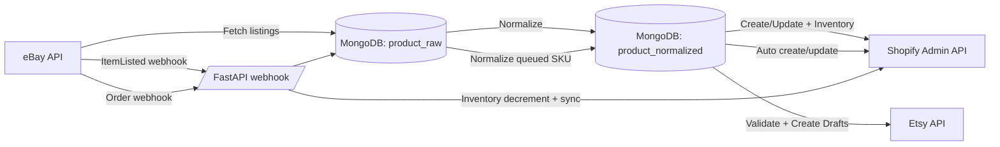

# eBay → Shopify Sync (Middleware)

FastAPI-based middleware that synchronizes inventory and listings across eBay,
Shopify, and Etsy.

## What this service does

**Data flow**

1. **Fetch from eBay** (Trading API): active listings via `GetMyeBaySelling` + per-item detail via `GetItem`
2. **Persist raw documents** to MongoDB (`product_raw`)
3. **Normalize/enrich** into a Shopify-friendly shape (`product_normalized`)
4. **Sync to Shopify** (Admin REST API): create/update products + keep inventory aligned
5. **Prepare and publish Etsy drafts** through persistent, resumable validation runs
6. **Audit channel state** for sold-but-live, duplicate, unlinked, missing-SKU, publish-ready, and low-resolution-image records
7. **Handle eBay listing webhooks (`ItemListed`)**: ingest new listing → normalize by SKU → auto-create/update Shopify product
8. **Handle marketplace order webhooks**: decrement inventory through the multichannel worker and propagate quantity changes to downstream channels

Mermaid overview:



## Key features

- **Async I/O** throughout (FastAPI + Motor + aiohttp)
- **Production-only Shopify operations** via `/sync/prod/*`
- **Inventory correctness**: updates Shopify inventory using `inventory_item_id + location_id` when available, with a fallback variant-based method
- **Shopify rate limiting** built in (2 req/s) in `ShopifyClient`
- **Hard exclusions**: block specific normalized docs from ever syncing to Shopify via `BLOCKED_SHOPIFY_TAGS`
- **Optional LLM enrichment**: OpenAI integration is present and only activates when `OPENAI_API_KEY` is set

## Repo structure

- `app/` — FastAPI app, API routes, services, platform clients
- `app/ebay/` — eBay Trading API client + fetch logic
- `app/normalizer/` — normalization pipeline helpers
- `app/shopify/` — Shopify API client + product/inventory operations
- `scripts/` — one-off scripts for manual operations and backfills
- `static/` — admin, audit, reporting, and Etsy publishing pages

## Requirements

- Python 3.12
- MongoDB connection string
- eBay developer app credentials (OAuth)
- Shopify Admin API credentials
- Etsy OAuth app credentials and an authorized shop

## Configuration

This project uses Pydantic Settings and reads environment variables from `.env` (see `app/config.py`).

### Required env vars

```bash
# Mongo
MONGO_URI=mongodb://localhost:27017
MONGO_DB=ebay_shopify_sync

# eBay OAuth
EBAY_APP_ID=...
EBAY_CERT_ID=...
EBAY_DEV_ID=...
EBAY_RUNAME=...   # eBay RuName / redirect-uri identifier from the eBay developer portal

# Optional fallback token (legacy/manual; DB OAuth is preferred)
EBAY_OAUTH_TOKEN=

# Shopify (PROD)
SHOPIFY_API_KEY_PROD=...
SHOPIFY_PASSWORD_PROD=...
SHOPIFY_STORE_URL_PROD=your-prod-store.myshopify.com

# Optional
OPENAI_API_KEY=

# Etsy
ETSY_CLIENT_ID=...
ETSY_CLIENT_SECRET=...
ETSY_REDIRECT_URI=...
ETSY_SHIPPING_PROFILE_ID=...
ETSY_RETURN_POLICY_ID=...
ETSY_READINESS_STATE_ID=...
```

## Local development

```bash
python -m venv venv
source venv/bin/activate
pip install -r requirements.txt

uvicorn app.main:app --host 0.0.0.0 --port 8080 --reload
```

- API root: `http://localhost:8080/`
- Swagger UI: `http://localhost:8080/docs`
- Admin page: `http://localhost:8080/admin`
- Audit dashboard: `http://localhost:8080/audit-dashboard`
- Etsy publishing page: `http://localhost:8080/etsy-publish-prep`
- eBay Intelligence: `http://localhost:8080/ebay-insights`

### Quick endpoint reference

- `GET /` — service status
- `GET /health` — simple health check (also available as `GET /health/`)
- `GET /products/?limit=50` — list normalized products from MongoDB
- `GET /audit-dashboard` — human-readable health/audit dashboard
- `GET /etsy-publish-prep` — persistent Etsy validation and bulk draft workflow
- `GET /ebay-insights` — eBay organic traffic, sales, listing age, and advertising intelligence
- `GET /audit/summary` — all inventory/listing audits in one response
- `GET /audit/sold-still-live` — sold products that still have an active Etsy listing
- `GET /audit/zero-quantity-unverified` — zero-quantity products without confirmed eBay sale evidence
- `POST /sync/prod/*` — production Shopify store operations
- `GET /auth/ebay/*` — eBay OAuth login/callback/status
- `GET|POST /webhooks/ebay/orders` — eBay listing + order webhook endpoints

See [BULK_PUBLISHING_GUIDE.md](BULK_PUBLISHING_GUIDE.md) for the complete,
resumable Etsy draft workflow and its API request bodies.

## Docker

```bash
docker build -t ebay-shopify-sync .
docker run --rm -p 8080:8080 --env-file .env ebay-shopify-sync
```

## Deploy to GCP Cloud Run

If you deploy to Cloud Run via Artifact Registry, the repo includes a helper so you don’t have to repeatedly type the build → push → deploy commands.

### Prereqs

- `gcloud auth login`
- `gcloud auth configure-docker ${REGION}-docker.pkg.dev`
- Artifact Registry repo exists (`$REPO`) and you have permission to push

### One-command deploy

```bash
export PROJECT_ID=gallery1880
export REGION=us-central1
export REPO=my-repo
export SERVICE=my-service

# Recommended: unique tag per deploy
TAG=$(git rev-parse --short HEAD) make deploy
```

Other options:

```bash
# Defaults TAG=latest
make deploy

# Preview without executing
DRY_RUN=1 make deploy

# Or run the script directly
./scripts/deploy_cloud_run.sh
```

## How to run a sync

This service exposes **step-by-step** endpoints and also has a few helper scripts.

### 1) Authorize eBay (OAuth)

1. Visit: `GET /auth/ebay/login`
2. After authorizing, eBay redirects to `GET /auth/ebay/callback`
3. Verify token status: `GET /auth/ebay/status`

Tokens are stored in MongoDB in the `ebay_oauth_tokens` collection (document id `primary`).

### 2) Fetch raw eBay listings

- `POST /sync/prod/sync-ebay-raw`

Writes to `product_raw` (upsert by SKU). SKUs not returned in the latest fetch are marked with `raw.QuantityAvailable = 0` to propagate ended/sold items downstream.

### 3) Normalize raw → normalized

- `POST /sync/prod/normalize-raw`

Writes to `product_normalized`.

### 4) Sync normalized → Shopify

- `POST /sync/prod/sync-shopify`

Body is optional and defaults to syncing everything:

```json
{"new_products": true, "zero_inventory": true, "other_updates": true}
```

Additional targeted endpoints:

- Create only new products (no updates):
	- `POST /sync/prod/sync-shopify-new?limit=50`
- Inventory-only enforcement:
	- `POST /sync/prod/sync-shopify-inventory?only_zero=false&limit=200&dry_run=true`
- Run queued downstream inventory updates:
	- `POST /sync/prod/multichannel/run-worker?limit=25`
- Reconcile one SKU against selected channels:
	- `POST /sync/prod/multichannel/reconcile/{sku}` with `{"channels": ["etsy", "shopify"], "reason": "manual_reconcile"}`
- Replay failed multichannel jobs:
	- `POST /sync/prod/multichannel/replay-failed`
- Enqueue and run Etsy draft jobs:
	- `POST /sync/prod/etsy-publish/enqueue/{sku}`
	- `POST /sync/prod/etsy-publish/run-worker?limit=10`

### Destructive operations (use with care)

- `POST /sync/prod/purge-shopify` — deletes Shopify products in the production store

## Etsy bulk draft publishing

The supported workflow is the persistent run UI at `GET /etsy-publish-prep`.
Runs and per-item results are stored in MongoDB, so validation and creation can
be resumed after a browser refresh or request timeout.

Important endpoints:

- `POST /reporting/etsy-publish/refresh` — refresh eBay raw data, normalized products, the Etsy listing snapshot, and Seller Taxonomy
- `POST /reporting/etsy-publish/runs` — create a run with `{"all": true}` or `{"skus": ["..."]}`
- `POST /reporting/etsy-publish/runs/{run_id}/process?limit=3` — process the next validation batch; repeat until `counts.queued` is zero
- `GET /reporting/etsy-publish/runs/{run_id}` — get status, counts, and taxonomy review items
- `GET /reporting/etsy-publish/run-management/latest` — reopen the newest run
- `PUT /reporting/etsy-publish/runs/{run_id}/items/{sku}/taxonomy` — approve a taxonomy or exclude an item
- `POST /reporting/etsy-publish/runs/{run_id}/create` — create ready Etsy drafts; requires `{"confirmed": true}`
- `GET /reporting/etsy-publish/runs/{run_id}/report.xlsx` — download validation and creation results as Excel

Creation requests accept at most 50 items. The UI uses batches of 10 and its
**Create All Ready Drafts** action repeats batches until no auto-approved items
remain. Items still requiring taxonomy review do not block already approved
items.

### Durable browser-independent operations

The Etsy Publish Prep page submits Refresh, Prepare/Validate, Publish, Canary,
and Retry actions to Cloud Tasks. Operation state and progress are stored in the
MongoDB `durable_operations` collection. The browser only polls that state, so
closing the tab, changing devices, or losing a request does not stop the work.

The deploy helper creates the `etsy-background` queue, stores a stable worker
secret in Secret Manager, grants the Cloud Run service identity permission to
enqueue tasks/read the secret, and configures these service variables:

- `GOOGLE_CLOUD_PROJECT`
- `GOOGLE_CLOUD_REGION` / `CLOUD_TASKS_LOCATION`
- `CLOUD_TASKS_QUEUE`
- `CLOUD_RUN_SERVICE_URL`
- `CLOUD_TASKS_WORKER_SECRET` (Secret Manager reference)

The queue is intentionally limited to one concurrent dispatch per second so
Etsy validation and publishing remain serialized. Each task processes one
bounded checkpoint and schedules the next; Cloud Tasks retries transient
failures, while MongoDB leases prevent two workers from processing the same
checkpoint concurrently.
See [BULK_PUBLISHING_GUIDE.md](BULK_PUBLISHING_GUIDE.md) for canary,
retry, and Excel-report details.

When a creation request supplies a quantity/limit, Ready products are selected
newest to oldest by their eBay listing start date. Older saved runs are
backfilled from the source product dates before selection.

## Audit dashboard and API

Open `GET /audit-dashboard` for the front end or poll these JSON endpoints:

- `GET /audit/summary` — every audit in one call
- `GET /audit/sold-still-live` — confirmed eBay sales with an **active** Etsy listing
- `GET /audit/zero-quantity-unverified` — zero-quantity products with an active Etsy listing but no eBay sale evidence
- `GET /audit/duplicates` — SKUs appearing on multiple active Etsy listings
- `GET /audit/missing-skus` — Etsy listings without an inventory SKU
- `GET /audit/unlinked` — Etsy listings not linked to a normalized product
- `GET /audit/publish-queue` — products eligible to publish to Etsy
- `GET /audit/low-res-images` — Shopify products whose image URL is not the expected high-resolution variant

These routes return a consistent `audit`, `status`, `count`, `items`, and
`ran_at` envelope. Etsy audits use the locally stored listing snapshot; refresh
that snapshot after an out-of-band Etsy change before treating the audit as
current.

## Webhooks

### eBay webhooks (`/webhooks/ebay/orders`)

Endpoint:

- `GET /webhooks/ebay/orders` — challenge/verification helper
- `POST /webhooks/ebay/orders` — receives both listing and order notifications

#### `ItemListed` automation (new eBay listing → Shopify product)

When eBay sends `NotificationEventName=ItemListed`, the service:

1. Extracts item data (`ItemID`, `SKU`, `Title`, `Description`, `PictureDetails.PictureURL`, quantity, price)
2. Upserts a raw record into `product_raw` (source: `ebay_itemlisted`)
3. Queues SKU in `ebay_listing_sync_queue`
4. Runs queue worker (`process_ebay_listing_sync_queue`) to:
   - normalize that SKU (`normalize_from_raw(skus=[sku])`)
   - sync to Shopify (`sync_to_shopify(..., allow_create=True, skus=[sku])`)

This is the near-real-time automation path used for creating Shopify products from new eBay listings.

#### Image-resolution caveat on webhook-created products

`ItemListed` currently stores eBay `PictureURL` values as-is. If eBay sends URLs with low-res suffixes (for example `$_1.JPG`, `$_0.JPG`), those same URLs flow into `product_normalized.images` and then into Shopify product images.

To upgrade images to full resolution after ingestion, run:

- `python -m scripts.renormalize_with_hires_images`
- `python -m scripts.update_shopify_images_graphql --shopify-ids-file <generated_ids_file>`

#### Repair sold inventory across Shopify and Etsy

Preview eBay records with `QuantityAvailable=0` whose normalized quantity or
active Etsy listing still needs correction:

```bash
python -m scripts.fix_zero_quantity_mismatch --dry-run
```

Apply quantity `0` to MongoDB and linked Shopify variants, and deactivate linked
active Etsy listings:

```bash
python -m scripts.fix_zero_quantity_mismatch
```

Use `--skip-shopify` or `--skip-etsy` to omit a remote channel, and `--verbose`
to include records skipped during the scan. A successful Etsy deactivation now
updates the local normalized record and investigation snapshot immediately.
Run this separate refresh only after manual/out-of-band Etsy changes or when
reconciling older repairs:

```bash
python -m scripts.sync_etsy_listings_investigation --shop-id <ETSY_SHOP_ID>
```

#### Order webhook processing

- Finds the corresponding `product_normalized` doc by SKU
- Applies a canonical sale event + inventory decrement flow
- Enqueues downstream channel inventory sync jobs (including Shopify)
- Writes a summary record to `sync_log`

Note: `app/api/routes/webhooks.py` currently contains a verification token and endpoint URL as constants. For production usage, those should be moved to environment variables or a secret manager.

## Shopify exclusions (policy / compliance)

Some items must never be created/updated in Shopify. This is enforced in `app/services/shopify_exclusions.py`.

- Update `BLOCKED_SHOPIFY_TAGS` to reflect your policy constraints
- Any normalized doc containing a blocked tag is skipped by the sync worker

## Useful scripts

- Fetch eBay and print a sample: `python -m scripts.test_ebay_fetch`
- Run Shopify sync script: `python -m scripts.run_full_sync`

Note: `scripts/run_full_sync.py` currently runs the Shopify sync step; the normalization call is present but commented out.

## Platform & compliance posture (important for reviews)

- **No scraping**: this project is intended to use official APIs (eBay OAuth + Trading API, Shopify Admin API).
- **Rate limiting**: Shopify requests are throttled in the client.
- **Credentials**: secrets are expected via environment variables (not committed).
- **Data storage**: raw and normalized product data is stored in MongoDB to support repeatable syncs; OAuth tokens are stored in MongoDB; webhook handling persists only processing summaries to `sync_log`.

## Etsy integration

Etsy access uses the official API and OAuth. The service supports listing
snapshot ingestion, draft preparation and creation, taxonomy review, inventory
deactivation for sold items, and multichannel inventory jobs. Only explicitly
authorized shops are accessed.

## License

### Etsy Insights

Open `/etsy-insights` from the workspace home page. Enter an Etsy shop ID, load
its saved dashboard, and use **Refresh Etsy data** to read live listings, the
last 90 days of orders, and customer reviews. The existing Etsy OAuth token is
reused; `listings_r` and `transactions_r` access are needed. If authorization
needs renewal, use `/auth/etsy/login`. No listing or inventory updates are made.

The dashboard includes 7/30/90-day sales, current views and favorites, product
search and filters, stock and review signals, product details, and CSV export.
Revenue is gross transaction price × quantity, before discounts, refunds,
shipping, tax, and fees. Currency totals are kept separate. Sales periods use
UTC calendar days, including today. Ratings cover all available reviews.

Each successful refresh saves one completed snapshot per shop per UTC day in
`etsy_insight_snapshots`; refreshing again replaces that day's snapshot.
Engagement changes require a snapshot at or before the selected period's start.
Snapshots are collected on refresh; no recurring collection is enabled.
`etsy_insight_status` records refresh progress and prevents concurrent refreshes
for the same shop. Failed listing/order reads preserve the previous completed
snapshot; unavailable reviews are explicitly reported. These collections do not
store customer names, addresses, emails, or credentials. Insight APIs use the
existing admin passkey protection.

Use `/etsy-insights?demo=1` for a clearly labeled sample dashboard without
reading Etsy or the database. To verify the feature:

```sh
PYTHONDONTWRITEBYTECODE=1 venv/bin/python -m unittest tests.test_etsy_insights -v
node --check static/etsy_insights.js
node tests/test_etsy_insights_csv.cjs
```
